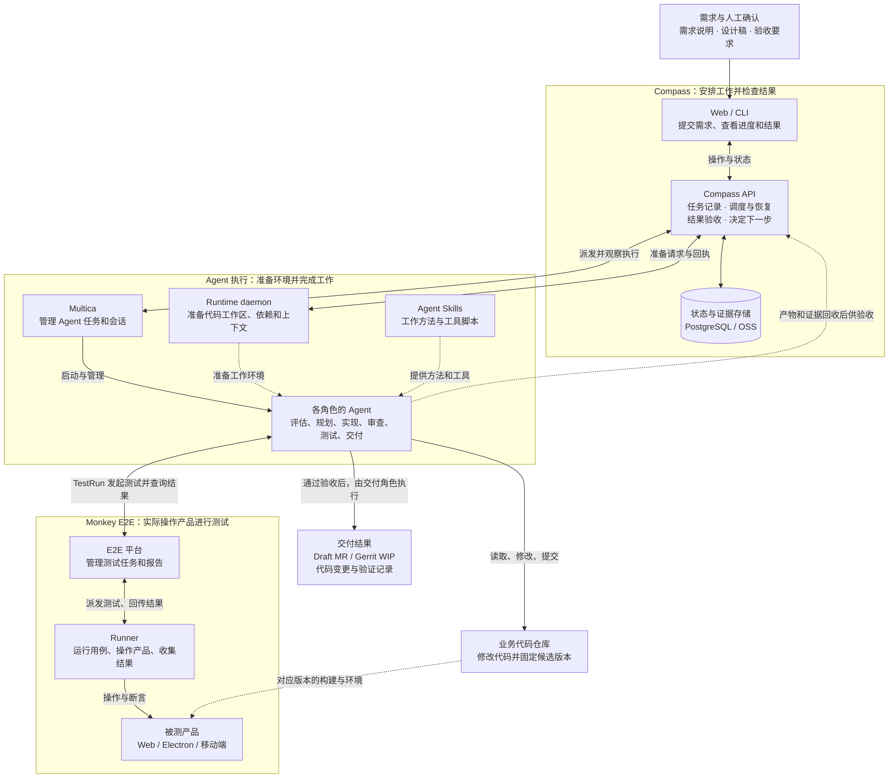

# Harness 全局认知：从需求到代码交付

**我先把这套 Harness 理解为：把 AI 写代码这件事，组织成一套有进度记录、能恢复、能验证、能交付的研发流程。**

这里的 Harness 指团队围绕 Tutor Compass 建立的体系，包含 Multica、Runtime、Agent Skills 和 Monkey E2E。读完这篇，我应该能说清：一份需求交进去之后，谁安排工作，谁修改代码，谁准备环境，谁测试，最后凭什么进入交付。

## 为什么有了编码 Agent，还需要这套体系

Agent 可以理解目标、调用工具、读取和修改代码。这里的“工具”包括终端命令、文件操作和平台接口。Codex、Claude Code 是这套体系使用的编码 Agent 执行工具。

但一次研发任务还有许多跨越单次对话的问题：

| 实际会遇到的问题 | 平台需要补上的能力 |
| --- | --- |
| 任务持续很久，进程中途退出了 | 记录已经做到哪一步，判断能否继续或需要重新执行 |
| 几个 Agent 先后接手，理解可能不一致 | 明确每个角色的输入、输出，以及交接时保留哪些信息 |
| 本地能运行，换一台机器却缺依赖或工具 | 准备并检查工作环境，保留环境准备结果 |
| 代码写好了，但没有覆盖原始需求 | 组织独立审查与测试，收集结果再判断是否通过 |
| 测试后代码又改了 | 对齐需求、代码版本、测试结果和最终交付物 |

因此，这套体系同时处理两类工作：**让 Agent 完成开发，以及把整个过程管理清楚。**

“控制面”是架构文档里常见的词，在这里可以理解为：负责记录进度、安排工作、检查结果并决定下一步的部分。Compass 承担这个职责。

## 先看全局图

先沿着“需求 → Compass → Agent → 代码和测试 → 结果回到 Compass”读一遍，再看旁边提供环境和方法的部分。

图中的箭头表示职责和信息流，合并了中间的调用、轮询与产物回收步骤；它不是逐个接口的网络连接图。各分区也不等于不同服务器。

点击图表或右上角全屏图标可全屏浏览；电脑用滚轮缩放、拖动查看，手机用双指缩放、单指拖动，点击“适应窗口”可恢复完整关系图。

## 图中的几个名字，各自负责什么

### Compass：记录任务，安排工作，决定下一步

Compass 有 Web 页面、API 服务和命令行入口。Web 用来提交需求、看进度、查看产物和处理需要人工确认的事情；API 保存任务状态，派发执行，回收结果并推进流程。

比如“代码已经实现，接下来是否进入审查”“测试失败后应该返修还是先处理环境”，属于 Compass 要协调的问题。它通过规则和结果判断流程是否满足推进条件，实际模型执行由 Multica 管理。

Compass 使用 PostgreSQL 保存任务、执行和判定等记录，使用 OSS 对象存储保存较大的产物、快照和部分上下文内容。这里的“产物”包括方案、代码变更说明、测试报告等执行结果。

### Multica：管理一次次 Agent 执行

Multica 管理 Agent、任务和会话，负责启动并观察真实的 Agent 执行。Compass 把要做的工作交给它，再根据执行状态和产物判断后续流程。

可以把“实现代码”和“审查代码”理解为不同的 Agent 执行。它们承担不同职责，也分别留下执行记录。Agent 通过 Codex 或 Claude Code 调用模型和工具完成工作。

### Runtime daemon：把工作的地方准备好

daemon 指在机器上持续运行、等待处理请求的程序。Runtime daemon 负责准备代码工作区、依赖、Skill、工具和任务上下文，并返回准备结果。

“工作区”就是这次任务实际读取、修改代码的目录。新执行能否继续使用原来的目录和会话，还是需要创建新的环境，是后续研究恢复机制时的重要问题。

架构中还会出现 Memory，可以先理解为后续执行需要继承的工作记录和上下文；它不是模型自动永久记住了整个项目。

### Agent Skills：告诉 Agent 怎样做具体工作

Skills 保存工作方法、操作约定、参考资料和工具脚本。例如怎样检查项目、准备测试，或者通过脚本完成一组固定操作。

这里有两类内容：需要 Agent 理解和判断的方法，以及由程序按固定步骤执行的工具。像检查文件、准备资源这类机械操作，适合交给工具脚本。

流程有哪些阶段、每个 Agent 的输入输出约定、结果如何验收，仍在 Compass 的定义和实现中。Skills 为这些角色提供工作办法。

### Monkey E2E：把“需要测试”落实为真实操作

E2E 是端到端测试，可以先理解为：按照用户实际使用产品的路径执行操作，并检查结果是否符合预期。例如打开课堂、点击入口，再检查面板是否正确显示。

Monkey E2E 分成管理平台与 Runner。平台负责测试任务、调度和报告；Runner 才实际运行用例、操作产品、收集结果。“断言”就是用例里对预期结果的检查。

**Runtime daemon 准备 Agent 的工作环境；Runner 操作被测产品执行测试。** 两者名字都和运行有关，但职责不同。

## 用一个前端需求串起整个过程

下面是假设需求，用于理解各部分的配合，不代表一次已经完成的真实执行。

> 在课堂页面增加一个排行榜入口。满足展示条件时显示入口，点击后打开排行榜面板，关闭面板后继续正常使用课堂。

### 第一步：把需求和验收要求说清楚

提交内容需要包含需求说明、设计稿、相关项目，以及怎样才算做对。例如：什么条件下显示入口、打开哪个面板、关闭后保留什么状态。

需求评估角色（DevIntake）负责理解和整理这些信息。遇到不清楚的地方，需要补充或确认；错误的需求理解会影响后面所有步骤。

### 第二步：准备执行环境

Compass 选择本次执行使用的 Runtime 和 Agent 配置，通过 Multica 管理执行，同时协调 Runtime daemon 准备工作区、依赖和上下文。

环境准备会在相应角色执行前进行，包括需求评估阶段；整个任务可能准备多次工作环境。

这一步准备的是“让 Agent 能开始工作”的条件。如果依赖缺失或工作区没有准备好，需要先处理这些问题，才能判断产品代码本身是否有问题。

### 第三步：分别规划、实现和审查

代码规划（Plan）先决定入口放在哪里、涉及哪些组件、状态和接口，以及准备怎样验证。代码实现（Implement）按方案修改代码。独立审查（Review）再检查变更是否满足要求、是否引入问题。

在示例中，不能只检查“有一个按钮”。还要检查入口是否处于正确的页面生命周期、显示条件是否正确、面板关闭后是否破坏课堂状态。

这些角色被拆成可分别观察的执行，Compass 可以记录是哪一步失败，并据此决定后续动作。

### 第四步：固定本次要测试的代码版本

准备测试时，需要明确测试针对哪一份代码。文档里的 Candidate 指本次待验证的候选代码版本，可以包含多个仓库对应的提交。

如果测试的是版本 A，后来代码又变成版本 B，就不能直接把 A 的通过结果当成 B 已经通过。这是代码修改、测试报告和最终交付之间必须保持一致的关系。

### 第五步：通过测试体系操作真实产品

测试角色（TestRun）根据需求和已有测试资产组织验证，通过 Monkey E2E 发起测试、查询结果并收集证据。Runner 实际操作产品。

对这个示例，测试需要覆盖入口的显示条件、点击后的面板、关闭后的课堂状态。代码生成了、页面打开了、测试进程结束了，都不能单独说明这些要求全部满足。

### 第六步：回收结果，再决定推进还是处理问题

Compass 回收代码说明、审查结论、测试报告等产物，检查是否满足该阶段的验收规则。

如果测试揭示的是产品实现问题，可能需要返回代码阶段修改；如果是设备、环境或测试资产问题，则需要处理对应原因。具体重试、恢复和等待方式由流程规则与当前状态决定。

### 第七步：交付已经验证的版本

满足交付条件后，交付角色（Delivery）整理代码和验证记录，创建 GitLab Draft MR 或 Gerrit WIP。它们都是供进一步审阅的代码变更，后续合并和发布还有各自的流程。

实际任务可以只选择部分阶段，并在关键位置等待人工确认。这条完整流程说明的是角色之间如何衔接。

## 怎样理解“完成”与“通过”

最容易混淆的是把不同层面的完成当成同一件事。

| 看到的结果 | 能说明什么 | 还需要确认什么 |
| --- | --- | --- |
| Runtime 准备完成 | 本次工作环境已按准备流程就绪 | Agent 是否正确完成任务 |
| Agent 执行结束 | 一次执行已经结束 | 结束状态、产物完整性和阶段验收结果 |
| Runner 运行结束 | 一次测试执行已经结束 | 用例是否成功，失败属于哪类问题 |
| 测试断言通过 | 被执行的检查满足了预期 | 检查是否覆盖原始需求，是否对应交付版本 |
| Compass 阶段通过 | 当前结果满足该阶段已有规则 | 规则本身是否足以发现业务和设计偏差 |

独立审查和测试能增加检查机会，但如果它们都继承了同一个错误理解，仍可能一起漏掉问题。已有的规划偏差复盘就记录过这类情况。因此，理解体系时，还要继续追问：**每个结论依据什么，这个依据能证明到哪一步？**

## 代码分别在哪里

先按职责找到仓库，再读入口文件，比一次展开全部目录更容易建立联系。

| 仓库或依赖 | 主要包含什么 | 想研究什么时看它 |
| --- | --- | --- |
| [tutor-compass](https://gitlab-ee.zhenguanyu.com/yuanli/tutor-compass) | Web、API、CLI、Runtime daemon、共享接口约定，以及流程和 Agent 定义 | 页面状态如何变化、任务怎样推进、失败如何恢复、结果如何验收 |
| [tutor-compass-agent-skills](https://gitlab-ee.zhenguanyu.com/yuanli/tutor-compass-agent-skills) | 工作方法、工具脚本和配套资源 | Agent 怎样完成具体工作，哪些步骤已由工具自动完成 |
| Multica | 独立的 Agent 执行依赖 | Agent 任务和会话怎样启动、观察与管理；内部部署对应的仓库版本需另外确认 |
| [tutor-monkey-e2e-platform](https://gitlab-ee.zhenguanyu.com/yuanli/tutor-monkey-e2e-platform) | 测试管理 Web、服务接口、调度和报告 | 测试任务怎样发起、分配和展示结果 |
| [tutor-monkey-e2e](https://gitlab-ee.zhenguanyu.com/yuanli/tutor-monkey-e2e) | Runner、CLI、SDK 和自动化执行能力 | 测试怎样真正操作浏览器、桌面应用和设备 |
| [tutor-electron-e2e](https://gitlab-ee.zhenguanyu.com/yuanli/tutor-electron-e2e) | 桌面端参考代码和测试资产 | 已有桌面测试怎样组织，有什么可参考或复用 |

从前端视角，先注意这里有两个 Web 系统：**Compass Web 展示研发任务，E2E 平台 Web 展示测试任务。** 前者使用 React / Vite，后者使用 Next.js。Compass API 使用 NestJS / PostgreSQL，E2E 平台使用 MySQL，它们承担不同的数据和业务职责。

业务产品本身的 Web、Electron 或移动端代码，属于被开发和被测试的对象，不等于 Harness 平台自身的客户端。

## 读完后，我应该能解释什么

先不看图，尝试用自己的话回答：

1. 一份需求进入后，谁负责记录进度、决定下一步？
2. Multica、Runtime daemon、Monkey Runner 分别负责什么？
3. Skills 提供的方法与 Compass 定义的流程有什么关系？
4. 为什么 Agent 结束、测试结束和需求通过验收是不同结论？
5. 怎样证明最后交付的代码，就是测试验证的那份代码？

下一步先研究建设背景和架构演进：理解真实问题怎样推动了这些拆分，再去追任务状态、调度恢复和证据管理的源码。

## 继续阅读的材料

本文按 2026-10-14 已检查的体系整理。下面的 GitLab 链接指向持续更新的分支；复盘中的历史问题需要再结合当前代码判断。

- [开发复盘](https://gitlab-ee.zhenguanyu.com/yuanli/tutor-compass/-/blob/master/docs/development-retrospective-2026-10-06.md)：先了解建设经过、实际案例和执行成本。
- [控制面架构](https://gitlab-ee.zhenguanyu.com/yuanli/tutor-compass/-/blob/master/docs/ARCHITECTURE-V3.md)：进一步看目标、系统边界、实体和调度机制。
- [代码规划偏差复盘](https://gitlab-ee.zhenguanyu.com/yuanli/tutor-compass/-/blob/master/docs/code-run-planning-retrospective.md)：理解为什么上游错误可能影响后续实现和测试。
- [E2E Runner 通信机制](https://gitlab-ee.zhenguanyu.com/yuanli/tutor-monkey-e2e-platform/-/blob/master/docs/runner-wss-transport.md)：了解测试平台与 Runner 如何连接和传递命令。

[返回 Harness 体系学习](./_index.md)
